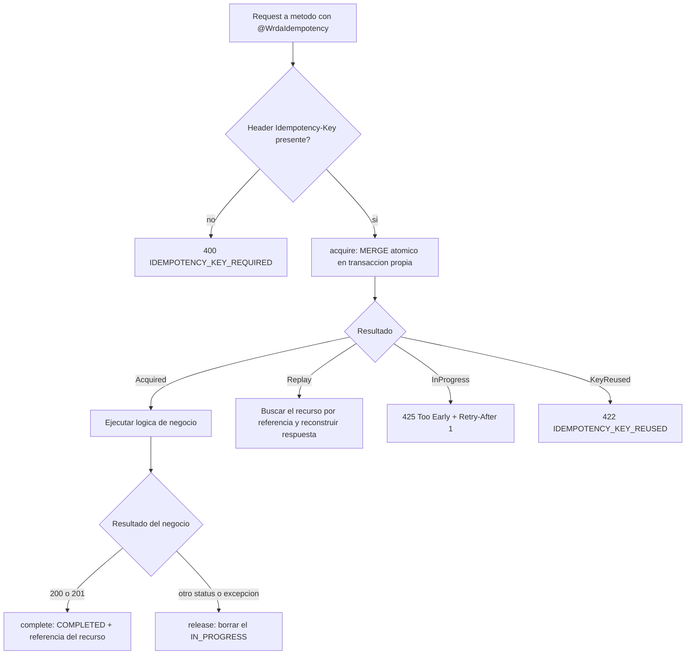
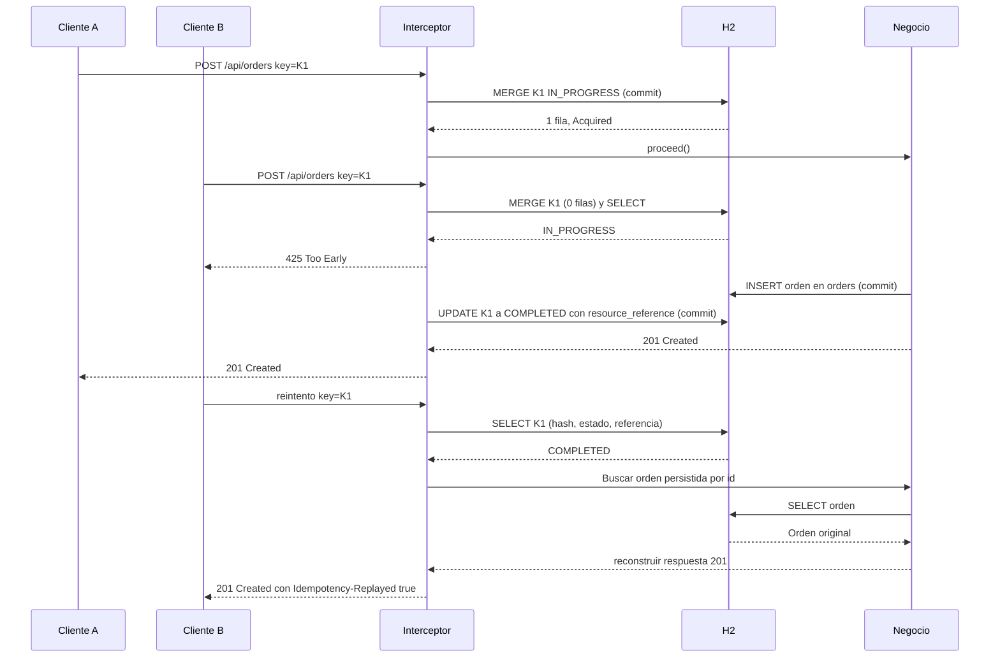

# wrda-idempotency-demo — guía de lectura y uso

Proyecto de ejemplo en **Quarkus 3.33 (LTS) + Java 21 + H2 en memoria + Panache** que implementa el
patrón *Idempotency Key / Replay* con una anotación propia: `@WrdaIdempotency`.

## 1. La idea principal

**Qué es:** un *interceptor CDI* que reclama la `Idempotency-Key` antes de ejecutar el negocio.
Después de crear el recurso, el registro de idempotencia conserva una referencia al recurso, no
una copia de todo el cuerpo HTTP. Un replay vuelve a leer el recurso persistido y reconstruye la
respuesta sin repetir la operación que lo creó.

**Qué NO es:**

| No es...                          | Porque...                                                                                                       |
|-----------------------------------|-----------------------------------------------------------------------------------------------------------------|
| Una API ni un microservicio       | Es una anotación + 4 clases que se copian dentro de tu API.                                                     |
| Un caché de respuestas            | Solo recuerda *intentos ya ejecutados con éxito*, no acelera lecturas.                                          |
| Una regla de unicidad de negocio  | Dos keys distintas = dos intentos válidos. Para "una cuenta por cliente" necesitas un UNIQUE de negocio aparte. |
| Exactly-once de extremo a extremo | Hay una ventana pequeña entre el commit del negocio y el guardado de la respuesta (ver sección 9).              |
| Un registro de errores            | Solo se guardan 200/201. Un fallo libera la key y el reintento se re-ejecuta.                                   |

Pensado para quien ya conoce APIs REST pero no el patrón: el cliente genera un UUID por *intención*
y lo manda en el header `Idempotency-Key`; reintentar con esa misma key nunca repite el efecto.

## 2. Conceptos estructurales y decisiones de diseño

| Decisión                                                                                                | Por qué existe                                                                        | Consecuencia a tener presente                                                                       |
|---------------------------------------------------------------------------------------------------------|---------------------------------------------------------------------------------------|-----------------------------------------------------------------------------------------------------|
| `IN_PROGRESS` se inserta en una transacción **propia** (`REQUIRES_NEW`) y se confirma antes del negocio | Otra petición con la misma key debe *verlo* al instante y responder `425` sin esperar | Si el proceso muere a mitad, queda un `IN_PROGRESS` huérfano → se retoma tras `in-progress-timeout` |
| El interceptor corre **por fuera** de `@Transactional` (prioridad 100 < 200)                            | `complete`/`release` deben ejecutarse *después* del commit o rollback del negocio     | Hay una ventana mínima entre ambos commits                                                          |
| `MERGE ... WHEN NOT MATCHED` + leer filas afectadas                                                     | Reclama la key atómicamente sin modificar una fila existente                          | Cero excepciones de clave duplicada en el camino de concurrencia                                    |
| Solo 200/201 se guardan                                                                                 | Un error debe poder reintentarse con la misma key                                     | El reintento re-evalúa con el estado actual del negocio                                             |
| El resource devuelve `Response` e implementa `IdempotencyReplayHandler`                                 | El interceptor necesita status y una referencia a un recurso persistido               | El replay reconstruye la respuesta sin guardar el body en `idempotency_keys`                        |
| Fechas como epoch en milisegundos                                                                       | Facilita comparar y expirar registros                                                 | Columnas `BIGINT`                                                                                   |

**Malentendidos comunes**

- *"425 y 409 son lo mismo."* Aquí `425 Too Early` significa "la misma key sigue ejecutándose,
  reintenta"; `422` significa "esa key ya se usó con otro body".
- *"Si el negocio falla, la key queda quemada."* No: se borra el `IN_PROGRESS`.
- *"La key es única por usuario."* Aquí es global; en un caso real prefija con el usuario o cliente
  (`<clienteId>:<key>`).

## 3. Flujo de decisión



## 4. Recorrido de dos peticiones concurrentes



## 5. Paso a paso: del build al resultado

1. **Contrato.** OpenAPI Generator lee `src/main/openapi/orders.yaml` durante `generate-sources`
   y genera `OrdersApi` y los modelos HTTP.
2. **Build.** `OrderResourceAdapter` implementa el contrato generado; ArC aplica los interceptores
   CDI a su operación.
3. **Arranque.** `SchemaInitializer` ejecuta `db/schema.sql` (idempotente: `IF NOT EXISTS`).
4. **Request.** Llega `POST /api/orders`; `WrdaErrorManagementInterceptor` envuelve el flujo para
   convertir excepciones a `AtlasError`, y `WrdaIdempotencyInterceptor` gestiona la key.
5. Valida el header `Idempotency-Key` (`400` si falta), calcula su hash para no guardar la key en
   claro y calcula `request_hash` (SHA-256 de método + path + parámetros de la solicitud).
6. Llama a `IdempotencyService.acquire` (transacción corta): `MERGE ... WHEN NOT MATCHED`.
    - 1 fila insertada → eres el primero → `Acquired`.
    - 0 filas → lee la fila existente y decide: `Replay`, `InProgress`, `KeyReused`, o retoma un
      `IN_PROGRESS` huérfano.
7. Si `Acquired`: `ctx.proceed()` ejecuta el negocio (aquí, el `Thread.sleep`).
8. La orden queda guardada en `orders`. Para `201`, `complete` guarda el estado y solo el UUID de
   la orden como `resource_reference`; no serializa la respuesta. Otros status o excepciones
   liberan la key.
9. El cliente recibe la respuesta. Un reintento con la misma key no repite la creación: busca la
   orden por UUID y construye de nuevo el `201`.

## 6. Estructura del repositorio

El código está organizado en arquitectura hexagonal a nivel de paquetes, sin añadir módulos Maven
ni capas innecesarias:

```
wrda-idempotency-demo/
├── pom.xml                              Dependencias, OpenAPI Generator y H2
└── src/main/
    ├── openapi/
    │   └── orders.yaml                 Contrato OpenAPI de orders/payments y AtlasError
    ├── resources/
    │   ├── application.properties       Datasource H2, parámetros de idempotencia
    │   └── db/schema.sql                DDL de idempotency_keys, orders y payments
    └── java/com/wrda/
        ├── domain/                       Dominio de negocio (Order, Payment y validación)
        ├── application/
        │   ├── orders/                   Casos de uso y puertos de orders/payments
        │   └── idempotency/              Servicio técnico y puerto de persistencia
        └── infrastructure/
            ├── orders/http/              Adaptadores REST generados para orders/payments
            ├── orders/persistence/       Entidades y repositorios Panache
            ├── orders/replay/            Estrategias para order, payment y order-payment
            ├── error/                    WrdaErrorManagement y AtlasError de ejemplo
            └── idempotency/              Interceptor CDI, Panache, esquema y limpieza
```

La idempotencia es una capacidad técnica transversal, no parte del dominio de `Order`. Su servicio
de aplicación coordina el protocolo y depende del puerto `IdempotencyStore`; Panache, H2 y el
interceptor HTTP quedan en infraestructura. Se conserva dentro de `application` solo la
orquestación necesaria para que la regla sea reutilizable, sin inventar un dominio de idempotencia.

### Replay con recurso persistido

Las tablas `orders` y `payments` contienen los datos de negocio. `idempotency_keys` conserva solo
el SHA-256 de la key, el hash de la solicitud, estado, código de respuesta, `resource_type`, una
referencia a los recursos y fechas de control. No contiene `response_body` ni datos de cliente.

`IdempotencyReplayStrategyRegistry` selecciona la estrategia usando `resource_type`: `order`
reconstruye desde una orden, `payment` desde un pago y `order-payment` consulta la orden y el pago
creados juntos. En el último caso la referencia contiene ambos UUID. La operación compuesta persiste
ambas filas dentro de una misma transacción: si falla el pago, también se revierte la orden. Un replay
recupera los recursos guardados y vuelve a construir el `201`; **no repite la creación ni efectos
externos**. Las rutas GET permiten comprobar los registros persistidos.

La key queda aislada por método HTTP y ruta, de modo que la misma key puede usarse, por ejemplo,
para `POST /api/orders` y `POST /api/payments` sin colisionar. Dentro de cada ruta, el hash del body
impide reutilizar una key completada con otra petición.

No hace falta cifrar un cuerpo que ya no se guarda en la tabla idempotente. Los hashes no son
cifrado: para solicitudes con datos sensibles o de baja entropía, conviene usar un HMAC con secreto
gestionado fuera del código. Los datos de negocio de `orders` requieren sus propios controles de
acceso y política de cifrado según el entorno.

### Contrato OpenAPI y manejo de errores

`mvn generate-sources` genera el contrato JAX-RS y los modelos desde
`src/main/openapi/orders.yaml`. `OrderResourceAdapter` solo implementa `OrdersApi`; las rutas y los
DTO de entrada/salida no se mantienen a mano.

`@WrdaErrorManagement` convierte excepciones tipadas a respuestas `AtlasError`:
`DomainException` → `422/DOMAIN`, `ApplicationException` → `500/APPLICATION` e
`InfrastructureException` → `500/INFRASTRUCTURE`. Las excepciones desconocidas se registran y se
devuelve un error genérico `500/UNEXPECTED`, sin filtrar detalles internos. El `AtlasError` actual
es un modelo de demostración generado por OpenAPI; se reemplaza en el contrato por el tipo real de
Atlas al integrar su dependencia.

`@WrdaManagedEndpoint` combina `@WrdaIdempotency` y `@WrdaErrorManagement`. Sí se pueden componer
bindings CDI de esta forma. El interceptor de errores tiene prioridad exterior para convertir
también fallos ocurridos al reclamar o persistir la key; el interceptor de idempotencia libera la
key antes de propagar fallos del caso de uso.

El `AtlasError` incluido es un modelo local de ejemplo (`code`, `message`, `category`). Para usar
Atlas real, reemplaza el esquema OpenAPI y el mapper que construye ese modelo por el tipo oficial de
Atlas; las anotaciones y el manejo tipado de excepciones se pueden conservar.

## 7. Configuración

| Propiedad                                          | Ejemplo                                                                              | Para qué sirve                                                                                               |
|----------------------------------------------------|--------------------------------------------------------------------------------------|--------------------------------------------------------------------------------------------------------------|
| `quarkus.datasource.db-kind`                       | `h2`                                                                                 | Usa la extensión JDBC de H2 incluida en el proyecto                                                          |
| `quarkus.datasource.jdbc.url`                      | `jdbc:h2:mem:idempotency;DB_CLOSE_DELAY=-1;DB_CLOSE_ON_EXIT=FALSE;LOCK_TIMEOUT=5000` | Base en memoria; se crea al arrancar y sus datos se pierden al detener la aplicación                         |
| `quarkus.hibernate-orm.schema-management.strategy` | `none`                                                                               | El esquema lo crea `SchemaInitializer`, no Hibernate                                                         |
| `wrda.idempotency.ttl`                             | `PT24H`                                                                              | Cuánto tiempo se puede hacer replay de una key                                                               |
| `wrda.idempotency.in-progress-timeout`             | `PT30S`                                                                              | Edad a partir de la cual un `IN_PROGRESS` se considera huérfano. Debe superar la duración máxima del negocio |
| `wrda.idempotency.cleanup-every`                   | `5m`                                                                                 | Frecuencia del job de limpieza                                                                               |

## 8. Compilar, ejecutar y probar

**Requisitos:** JDK 21, Maven 3.9+.

```bash
mvn generate-sources                             # genera OrdersApi y sus modelos
mvn quarkus:dev                                   # modo desarrollo
# o bien:
mvn package && java -jar target/quarkus-app/quarkus-run.jar
```

Al arrancar debes ver `Esquema de idempotencia listo`. H2 crea la base en memoria automáticamente:
no requiere instalar una base de datos ni compartir un archivo entre laptops. Los datos de prueba
se reinician al detener la aplicación.

### Caso 1: primera llamada exitosa (terminal A)

```bash
curl -i -X POST http://localhost:8080/api/orders \
  -H "Content-Type: application/json" \
  -H "Idempotency-Key: order-001" \
  -d '{"customerId":"C-100","amount":150.50}'
```

Tarda de 3 a 5 s y responde `201 Created` con `orderId` y `Location`.

### Caso 2: llamada concurrente mientras la 1ª se procesa (terminal B, dentro de esos 3 a 5 s)

```bash
curl -i -X POST http://localhost:8080/api/orders \
  -H "Content-Type: application/json" \
  -H "Idempotency-Key: order-001" \
  -d '{"customerId":"C-100","amount":150.50}'
```

Responde **al instante** `425 Too Early` con `Retry-After: 1` y
`{"code":"REQUEST_IN_PROGRESS",...}`.

### Caso 3: llamada posterior con la misma key (replay)

Con el mismo comando, ya terminada la 1ª: responde al instante `201 Created`, header
`Idempotency-Replayed: true` y **el mismo** `orderId` y `createdAt`. En el log de la aplicación no
aparece un nuevo "Procesando orden".

### Consultar la orden almacenada

Usa el `orderId` que aparece al final de `Location`:

```bash
curl -i http://localhost:8080/api/orders/<orderId>
```

El endpoint `GET` lee el mismo registro persistido que el replay utiliza para reconstruir el `201`.

### Pago individual y creación compuesta

Se puede crear un pago para una orden existente con `POST /api/payments`; su replay reconstruye
`PaymentResponse` desde `payments`:

```bash
curl -i -X POST http://localhost:8080/api/payments \
  -H "Content-Type: application/json" -H "Idempotency-Key: payment-001" \
  -d '{"orderId":"<orderId>","amount":150.50}'
```

`POST /api/orders/with-payment` demuestra el caso donde una petición crea filas en dos tablas:

```bash
curl -i -X POST http://localhost:8080/api/orders/with-payment \
  -H "Content-Type: application/json" -H "Idempotency-Key: order-payment-001" \
  -d '{"customerId":"C-100","amount":150.50}'
```

La respuesta contiene `order` y `payment`. Repetir la llamada con la misma key/body devuelve ambas
entidades persistidas, con sus mismos IDs, sin crear registros adicionales.

### Caso 4: un fallo no bloquea los reintentos

```bash
# Falla con 500/APPLICATION despues del retardo
curl -i -X POST http://localhost:8080/api/orders \
  -H "Content-Type: application/json" -H "Idempotency-Key: order-002" \
  -d '{"customerId":"C-200","amount":99,"simulateFailure":true}'

# Misma key, ahora sin fallo: se EJECUTA (la key fue liberada) y responde 201
curl -i -X POST http://localhost:8080/api/orders \
  -H "Content-Type: application/json" -H "Idempotency-Key: order-002" \
  -d '{"customerId":"C-200","amount":99}'
```

### Caso 5: misma key con otro body, y key ausente

```bash
# 422 IDEMPOTENCY_KEY_REUSED (order-001 ya esta COMPLETED con otro body)
curl -i -X POST http://localhost:8080/api/orders \
  -H "Content-Type: application/json" -H "Idempotency-Key: order-001" \
  -d '{"customerId":"C-999","amount":1}'

# 400 IDEMPOTENCY_KEY_REQUIRED
curl -i -X POST http://localhost:8080/api/orders \
  -H "Content-Type: application/json" -d '{"customerId":"C-1","amount":1}'
```

### Concurrencia en una sola terminal

```bash
for i in 1 2 3 4; do
  curl -s -o /dev/null -w "peticion $i -> %{http_code}\n" -X POST http://localhost:8080/api/orders \
    -H "Content-Type: application/json" -H "Idempotency-Key: order-par-1" \
    -d '{"customerId":"C-300","amount":10}' &
done; wait
```

Esperado: una petición con `201` y tres con `425`. En el log, un solo "Procesando orden".

### Inspeccionar la tabla

La base de datos está en memoria y vive dentro del proceso de Quarkus; se puede consultar desde el
depurador o una herramienta H2 conectada al proceso. Al detener la aplicación, los datos se pierden.

`db/schema.sql` crea `orders`, `payments` e `idempotency_keys`. La tabla idempotente guarda metadata
y referencias a uno o varios recursos, no los datos de negocio ni una copia del body de respuesta.
H2 está en memoria; al detener la aplicación se reinician las tablas.

### Reutilizarlo en otra API

1. Copia el paquete `com.wrda.infrastructure.idempotency` y sus contratos de
   `com.wrda.application.idempotency` (o extráelos a una librería propia).
2. Agrega las dependencias del `pom.xml` y la tabla (`db/schema.sql`).
3. Anota tus métodos con `@WrdaIdempotency`. Deben retornar `jakarta.ws.rs.core.Response`.

## 9. Límites y consideraciones al interpretar resultados

- **Es una demo con H2 en memoria.** Es práctica para desarrollo local y pruebas, pero no conserva
  claves al reiniciar ni comparte estado entre instancias/procesos. Para producción usa una base
  compartida y adapta la operación atómica `MERGE` al motor elegido.
- **Ventana de inconsistencia.** El negocio y el `complete` son dos commits distintos. Si el proceso
  muere entre ambos, el negocio quedó hecho pero la key sigue `IN_PROGRESS`; tras
  `in-progress-timeout` un reintento volvería a ejecutarlo. Se mitiga con una regla de unicidad de
  negocio o propagando la key al sistema downstream.
- **`in-progress-timeout` mayor que tu operación más lenta.** Si es menor, una petición legítima
  lenta podría ser "retomada" por otra.
- **El hash cubre método, path y body**, no los headers.
- **El replay requiere que el recurso referenciado siga disponible.** Si se elimina la orden antes
  de que venza la key, no se puede reconstruir el replay; devuelve un error explícito en vez de
  ejecutar la creación otra vez.
- **El método anotado debe retornar `Response`** y sus parámetros deben ser serializables con
  Jackson (el body); evita parámetros `@Context`.
- **El `Thread.sleep`** solo existe para probar la carrera a mano; el método usa `@Blocking` para
  correr en un worker thread.

## 10. Ruta recomendada de lectura del código

1. `infrastructure/idempotency/http/WrdaIdempotency.java`: la anotación.
2. `src/main/openapi/orders.yaml` y `infrastructure/orders/http/OrderResourceAdapter.java`: contrato
   y adaptador HTTP.
3. `infrastructure/error/WrdaManagedEndpoint.java` y `WrdaErrorManagementInterceptor.java`: bindings
   compuestos y mapeo AtlasError.
4. `infrastructure/idempotency/http/WrdaIdempotencyInterceptor.java`: coordinación del request y
   replay.
5. `application/idempotency/IdempotencyService.java`: las reglas de decisión de `acquire`.
6. `application/idempotency/port/out/IdempotencyStore.java`: el puerto de persistencia.
7. `infrastructure/idempotency/persistence/IdempotencyRepository.java`: las sentencias atómicas y la
   referencia al recurso.
8. `application/idempotency/model/AcquireResult.java` y `IdempotencyStatus.java`: resultados y
   estados del protocolo.
9. `infrastructure/idempotency/persistence/IdempotencyRecord.java` y `db/schema.sql`: la metadata de
   idempotencia.
10. `infrastructure/orders/persistence/OrderRecord.java` y `OrderRepository.java`: persistencia de
    órdenes.
11. `application.properties`, `SchemaInitializer.java` y `IdempotencyCleanupJob.java`: configuración
    y mantenimiento.
