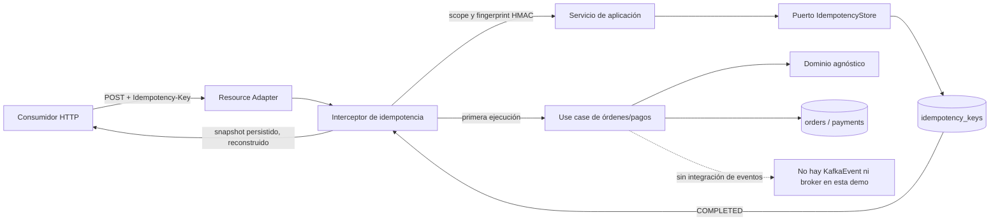
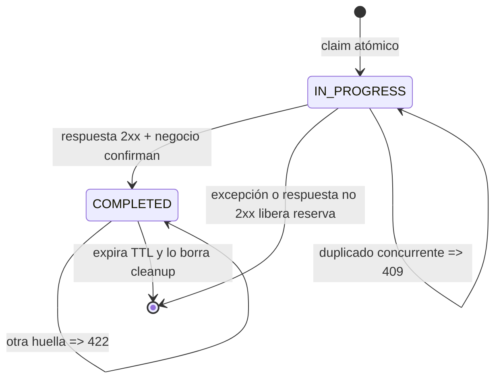
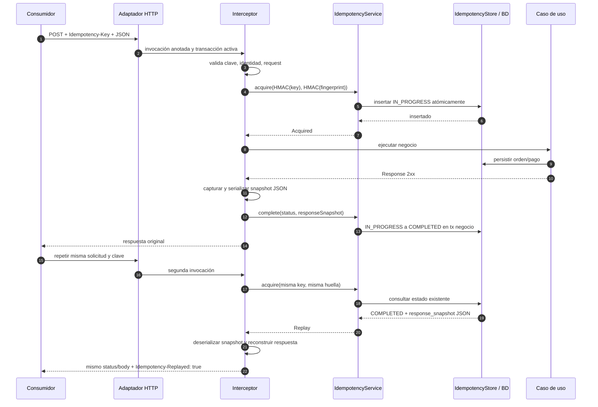

# WRDA Idempotency Demo

Demo de idempotencia HTTP para Quarkus 3.33 y Java 21. Usa CDI, Hibernate ORM/Panache y una base de datos relacional. La demo corre con H2 en memoria; no usa Redis.

## Qué garantiza

`@WrdaManagedEndpoint` combina el manejo de errores con `@WrdaIdempotency`. El interceptor reclama una clave antes de ejecutar el endpoint. Tras una respuesta 2xx, persiste el snapshot HTTP como JSON en `response_snapshot` dentro de `idempotency_keys`, sin cifrado de respuesta a nivel de aplicación. Un reintento con la misma clave, identidad y petición devuelve el mismo status, cuerpo y encabezados permitidos sin repetir el negocio ni volver a leer tablas de dominio.

Esto también funciona si la respuesta representa varias tablas. Por ejemplo, `POST /api/orders/with-payment` crea una orden y un pago, pero el replay no tiene que descubrir ni consultar esas tablas: recupera la instantánea original. La reserva `IN_PROGRESS`, los cambios de negocio y el estado `COMPLETED` se coordinan en la misma base. Los endpoints de escritura tienen `@Transactional`; el interceptor verifica que exista una transacción JTA activa y el guardado de `COMPLETED` se une a ella. Si la transacción falla, tanto el cambio de negocio como la instantánea se revierten.

La tabla no almacena la clave del cliente en claro. La clave y la huella de la solicitud se derivan con HMAC-SHA-256. La huella considera identidad/tenant, método, ruta, query y parámetros del endpoint serializados. Reutilizar una clave con otra huella responde `422`; una solicitud idéntica que continúa en proceso responde `409` con `Retry-After`.

## Protección de datos y secretos

La instantánea —status, cuerpo y encabezados seleccionados— se serializa como JSON y se persiste sin cifrado de aplicación en `response_snapshot`. La protección de confidencialidad en reposo se delega a la base de datos y a la configuración aprobada (por ejemplo, TDE en SQL Server); este repositorio no habilita ni configura TDE. Un usuario con permisos de lectura sobre la tabla puede ver el snapshot, y el cifrado en reposo no reemplaza TLS, control de acceso, cifrado/gestión de backups ni controles de aplicación. El tamaño máximo serializado es 1 MiB por defecto. Solo se aceptan respuestas JSON y texto no streaming. Se guardan encabezados permitidos (`Location`, `Cache-Control`, `ETag`, `Last-Modified`, `Expires`, `Content-Language` y `Vary`); no se guardan `Set-Cookie`, `Authorization` ni encabezados arbitrarios.

La clave HMAC no está en el repositorio. El runtime requiere `WRDA_IDEMPOTENCY_HMAC_KEY`, un secreto Base64 de al menos 32 bytes para derivar la clave persistida y la huella; en producción debe venir del secret manager aprobado. No se requieren claves de cifrado de respuesta de la aplicación.
- `WRDA_IDEMPOTENCY_REQUIRE_AUTHENTICATED_IDENTITY`: activar `true` en producción.

Generación local de secretos efímeros (no reutilizar en despliegues):

```bash
export WRDA_IDEMPOTENCY_HMAC_KEY="$(openssl rand -base64 32 | tr -d '\n')"
export WRDA_IDEMPOTENCY_REQUIRE_AUTHENTICATED_IDENTITY=false
mvn quarkus:dev
```

La identidad autenticada se incorpora al ámbito. Si existe el atributo `tenant_id` en `SecurityIdentity`, también se incorpora. El valor de `require-authenticated-identity` queda desactivado por defecto para que la demo local sin proveedor de autenticación funcione. En un despliegue bancario debe activarse, integrar el proveedor de identidad real y verificar que la identidad/tenant representan al cliente correcto. No se debe usar un header controlado por el usuario como ámbito de tenant.

El secreto HMAC debe permanecer estable durante la vida máxima de las claves guardadas; reemplazarlo sin una migración coordinada hace que los identificadores existentes dejen de ser localizables. La rotación HMAC requiere un procedimiento separado y validado. No hay claves de cifrado de respuesta administradas por la aplicación.

Esta versión cambia el almacenamiento de `encrypted_response` (cifrado por la aplicación) a `response_snapshot` (JSON legible por la aplicación). El DDL conserva la columna legacy, pero el código nuevo no la lee ni la descifra. Los registros COMPLETED previos no tendrán `response_snapshot`; sus reintentos fallarán cerrados y no volverán a ejecutar el negocio. Antes de desplegar, definir una ventana de transición: conservar filas anteriores hasta que expiren y aceptar que sus reintentos no podrán replayarse, o convertirlas controladamente mientras aún se disponga de la versión y claves antiguas. No borrar a ciegas filas vigentes.

La base debe tener habilitado y validado el cifrado en reposo requerido por el banco (p. ej. TDE en SQL Server); esta demo no lo configura. El cifrado en reposo no cifra las lecturas entregadas a sesiones autorizadas ni sustituye TLS, control de acceso, auditoría, backups cifrados, retención ni clasificación de datos del banco. La instantánea puede incluir información sensible de la respuesta: aplicar permisos mínimos a la tabla y backups, revisar qué APIs son elegibles, reducir el TTL al mínimo aprobado y no almacenar tokens/cookies en el cuerpo.

## Fallos y recuperación operativa

Los estados distintos de 2xx y las excepciones no se guardan como resultado replayable. Un estado no exitoso marca rollback de la transacción de negocio y libera la reserva. Una excepción también revierte negocio y libera la clave cuando el proceso sigue disponible.

No se retoma automáticamente una fila `IN_PROGRESS` por antigüedad. Hacerlo podría volver a ejecutar una operación que todavía está viva y producir efectos duplicados. Si el proceso muere, la clave queda bloqueada y devuelve `409` hasta recuperación operativa. Antes de liberar una reserva huérfana, el procedimiento operativo debe verificar en la base de negocio si la operación se confirmó; no borrar a ciegas. Es un comportamiento deliberadamente *fail closed*.

La reserva se confirma en una transacción corta antes del negocio. En contraste, los cambios de negocio y el paso a `COMPLETED` comparten la transacción del endpoint, en la misma base. Para efectos externos no transaccionales (por ejemplo, un proveedor de pagos), la transacción local no garantiza exactly-once. Usar una clave idempotente del proveedor y/o patrón outbox con evento agnóstico del dominio; no acoplar el dominio a Kafka u otro broker concreto.

## Arquitectura

- `domain`: entidades/validaciones de negocio, sin dependencias de idempotencia ni eventos concretos.
- `application/idempotency`: servicio de aplicación y puerto `IdempotencyStore`.
- `infrastructure/idempotency/http`: anotación CDI y componentes HTTP separados para validar la clave, construir la huella, resolver el ámbito de identidad, generar errores y capturar/reproducir respuestas.
- `infrastructure/idempotency/security`: HMAC para pseudonimizar clave y huella; la respuesta no se cifra en la aplicación.
- `infrastructure/idempotency/persistence`: Panache, SQL y limpieza de claves COMPLETED vencidas.
- `infrastructure/orders`: ejemplo HTTP y persistencia del dominio.

### H2 local y SQL Server

H2 permanece como configuración predeterminada para pruebas y desarrollo local (`mvn quarkus:dev`). Se agregó la extensión JDBC de SQL Server, un perfil `sqlserver`, un DDL específico (`schema-sqlserver.sql`) y una sentencia de reserva específica para SQL Server. En SQL Server la reclamación usa `MERGE ... WITH (HOLDLOCK)` junto con la clave primaria única; `HOLDLOCK` aplica semántica SERIALIZABLE sobre el rango de clave durante esa sentencia. La sentencia debe someterse a pruebas de concurrencia con la versión y configuración exacta de SQL Server antes de producción; Microsoft advierte probar cuidadosamente `MERGE` bajo carga concurrente.

Para ejecutar localmente apuntando a SQL Server:

```bash
export SQLSERVER_USERNAME='...'
export SQLSERVER_PASSWORD='...'
export SQLSERVER_JDBC_URL='jdbc:sqlserver://localhost:1433;databaseName=idempotency;encrypt=true;trustServerCertificate=true'
export WRDA_IDEMPOTENCY_HMAC_KEY="$(openssl rand -base64 32 | tr -d '\n')"
export WRDA_IDEMPOTENCY_REQUIRE_AUTHENTICATED_IDENTITY=false
mvn quarkus:dev -Dquarkus.profile=sqlserver
```

El perfil SQL Server selecciona `db-kind=mssql` y usa `dbo` en el DDL y en la reserva atómica; el usuario de conexión debe tener `dbo` como esquema por defecto o recibir permisos explícitos sobre `dbo`. El URL de ejemplo confía en el certificado del servidor para facilitar un SQL Server local; en entornos compartidos/producción configurar TLS validando certificado y hostname, sin `trustServerCertificate=true`. Crear la base de datos y conceder permisos con el proceso aprobado antes de iniciar la aplicación.

El inicializador de esquema sirve para la demo/local y crea objetos faltantes; no reemplaza un sistema de migraciones. En producción, usar migraciones SQL Server versionadas/aprobadas (Flyway, Liquibase o la herramienta institucional), deshabilitar el DDL de arranque si así se requiere, y revisar constraints, índices, nombres/esquemas, permisos y ventana de despliegue. Este repo no ejecutó integración contra una instancia SQL Server: las pruebas automatizadas actuales corren sobre H2. Antes de habilitar tráfico real, validar el DDL, la compatibilidad de `NVARCHAR(MAX)` con el mapeo JPA, el conteo de filas afectadas por `MERGE`, bloqueos/deadlocks, reintentos por deadlock/transient failure y benchmarks en la versión y nivel de aislamiento objetivo.

## Ejecución y comprobación manual

```bash
mvn test
mvn quarkus:dev
```

Crear una orden:

```bash
curl -i -X POST http://localhost:8080/api/orders \
  -H 'Content-Type: application/json' \
  -H 'Idempotency-Key: order-001' \
  -d '{"customerId":"C-100","amount":150.50}'
```

Repetir exactamente esa llamada devuelve la misma respuesta con `Idempotency-Replayed: true`. Cambiar el payload y conservar la clave devuelve `422`. Mientras la primera llamada esté activa, una petición simultánea devuelve `409`. La ruta `POST /api/orders/with-payment` prueba replay de respuesta compuesta.

Las pruebas de integración en `src/test` cubren replay byte-a-byte, rechazo de payload distinto, concurrencia, liberación luego de una falla, replay de orden+pago y que `response_snapshot` se persista como JSON sin cifrado de aplicación. `IdempotencyKeyValidatorTest` cubre headers ausentes/duplicados y claves inválidas. El secreto HMAC determinista de `src/test/resources/application.properties` es únicamente para las pruebas automatizadas.

### Ruta de lectura del interceptor

1. `WrdaIdempotency` define el binding CDI y `WrdaManagedEndpoint` lo combina con el manejo de errores.
2. `WrdaIdempotencyInterceptor` es el orquestador: valida precondiciones, coordina colaboradores y traduce el estado de adquisición a la respuesta HTTP.
3. `IdempotencyKeyValidator` valida el header, y `IdempotencyRequestIdentityResolver` obtiene el ámbito principal/tenant y deriva identificadores HMAC.
4. `RequestFingerprintBuilder` serializa método, ruta, query y argumentos HTTP excluyendo el parámetro `Idempotency-Key`.
5. `IdempotencyService` adquiere la reserva y decide entre continuar, replay, conflicto o reutilización de clave.
6. `IdempotencyResponseHandler` ejecuta el endpoint una sola vez, serializa el snapshot JSON en `response_snapshot` y reconstruye el replay. No cifra ni descifra la respuesta en la aplicación. `ResponseSnapshot` define qué cuerpo y encabezados se conservan.

## Alcance de producción

Este repositorio es una demo, no un artefacto certificado ni una solución lista para desplegar en un banco. Antes de producción se requieren revisión de seguridad, decisión aprobada sobre clasificación/retención de snapshots, gestión y rotación de claves, migraciones de esquema, base relacional y prueba de concurrencia del motor elegido, autenticación/tenant, observabilidad sin PII y procedimientos operativos para registros `IN_PROGRESS` huérfanos.


## Guía de estudio: del concepto al código

### Idea principal y límites de alcance

La clave de idempotencia es un identificador elegido por el consumidor para que pueda reintentar una operación de escritura si no sabe si la primera respuesta llegó. El servidor recuerda el resultado exitoso y lo reproduce para la misma operación. La garantía depende del scope, la ventana de retención y la persistencia compartida.

Esta demo **no** convierte HTTP en entrega exactly-once, no elimina fallos de red, no guarda resultados de error, no coordina una transacción con un broker/evento externo y no es una pasarela de pagos. El ejemplo de órdenes y pagos sí es un consumidor HTTP real de la implementación dentro de la misma aplicación Quarkus. La solución no usa Redis; en local, H2 en memoria hace de base relacional.



| Término | Papel en el flujo | Implementación |
|---|---|---|
| Clave cliente | Se envía una por operación lógica y se conserva al reintentar. | Header `Idempotency-Key`. |
| Clave persistida | Scope por principal/tenant, método y path; valor derivado, no la clave cliente en claro. | HMAC-SHA-256 (`IdempotencyHmac`). |
| Huella (fingerprint) | Permite distinguir repetición igual de reutilización incompatible. Considera scope, método, path, query y parámetros endpoint serializados. | `RequestFingerprintBuilder`. |
| Reserva | Exclusión atómica para una petición que todavía no terminó. | Estado `IN_PROGRESS`; `MERGE` nativo. |
| Resultado | Status + body + lista limitada de headers en `response_snapshot`. | Estado `COMPLETED`; protección en reposo delegada a la base. |
| Puerto | Interfaz que expresa operaciones necesarias sin imponer base/proveedor. | `IdempotencyStore`. |
| Adaptador | Implementación concreta en el borde del sistema. | CDI/JAX-RS, Panache/SQL, H2 o SQL Server. |

### Estados de una clave



Una fila `IN_PROGRESS` no se recupera automáticamente por antigüedad: el proceso original podría continuar ejecutándose. Si queda huérfana, el comportamiento intencionalmente conservador es responder `409` hasta recuperación operativa; no borrar a ciegas sin verificar el estado del negocio.

### Secuencia de la petición



Puntos para observar al leer el código: la reserva se confirma en una transacción nueva antes del caso de uso; `complete` se une a la transacción del endpoint; el resultado de negocio y el replay se confirman o revierten juntos. Si el endpoint falla o devuelve no-2xx, se libera la reserva, así el siguiente intento vuelve al handler.

## Recorrido por capas y estructura del repositorio

```text
src/main/java/com/wrda/
├── domain/                         # Order, Payment, reglas/invariantes
├── application/
│   ├── idempotency/                # Servicio, modelos y puerto de persistencia
│   └── orders/                     # Casos de uso + puertos OrderStore/PaymentStore
└── infrastructure/
    ├── error/                      # Binding de error y adaptador transversal
    ├── idempotency/
    │   ├── http/                   # Binding, interceptor, snapshot HTTP
    │   ├── persistence/             # Panache, SQL, schema init y cleanup
    │   └── security/                # HMAC de clave y fingerprint
    └── orders/
        ├── http/                   # Adaptadores JAX-RS y mapeadores
        └── persistence/             # Entidades/repositorios de órdenes/pagos
src/main/openapi/orders.yaml       # Contrato del API; genera interfaces/modelos
src/main/resources/application.properties
src/main/resources/db/schema.sql
src/main/resources/db/schema-sqlserver.sql
src/test/java/com/wrda/idempotency/IdempotencyReplayTest.java
src/test/resources/application.properties
pom.xml
```

| Capa | Conoce | No debería conocer |
|---|---|---|
| Dominio | Reglas de orden/pago y conceptos de negocio. | JAX-RS, Panache, H2, SQL Server, Kafka o formato de respuesta HTTP. |
| Aplicación | Casos de uso y puertos de salida. | Clases concretas del driver/ORM o detalles del broker. |
| Infraestructura | Protocolo HTTP, CDI, SQL, HMAC y proveedor de base. | Convertir esos detalles en dependencias del dominio. |

No se implementan eventos en este repo. Si se agregan, mantener un evento/intención agnóstico en las capas internas y traducirlo a Kafka u otro transporte solo en infraestructura. Una transacción de base local no hace atómica la publicación en un broker; para ese objetivo se requiere diseñar outbox/consumo idempotente según el caso.

### Esquema que respalda el replay

| Tabla | Uso | Columnas principales |
|---|---|---|
| `idempotency_keys` | Estado por clave opaca y snapshot reutilizable. | `idempotency_key` (HMAC PK), `request_hash` (HMAC), `status`, `status_code`, `response_snapshot`, `created_at`, `updated_at`, `expires_at` (epoch ms). |
| `orders` | Efecto de negocio de la demo. | `order_id`, `customer_id`, `amount`, `status`, `created_at`. |
| `payments` | Segundo efecto de negocio; relación con orden. | `payment_id`, `order_id` (FK), `amount`, `status`, `created_at`. |

El replay se obtiene de `response_snapshot`, no de volver a leer `orders`/`payments`. Esto permite reproducir la respuesta de la operación compuesta. El contenido se guarda en claro para la aplicación; protecciones de base, acceso y retención deben alinearse con la clasificación bancaria. `ResponseSnapshot` conserva status, media type, body y headers permitidos, no todos los headers de transporte.

## Endpoints consumidos por la demo

| Operación | Ruta | Requiere clave | Resultado normal |
|---|---|---:|---|
| Crear orden | `POST /api/orders` | Sí | `201`, JSON de orden y `Location`. |
| Crear orden y pago juntos | `POST /api/orders/with-payment` | Sí | `201`, JSON compuesto. |
| Crear pago para orden existente | `POST /api/payments` | Sí | `201`, JSON de pago. |
| Consultar orden | `GET /api/orders/{orderId}` | No | `200` si existe. |
| Consultar pago | `GET /api/payments/{paymentId}` | No | `200` si existe. |

## Compilar y ejecutar como consumidor HTTP

Se necesita JDK 21 y Maven; el repositorio no contiene `mvnw`. Las pruebas son de integración Quarkus con RestAssured, no solo pruebas unitarias de mocks:

```bash
mvn test
mvn package
```

Para iniciar la aplicación local, exporta secretos efímeros (solo para desarrollo; no guardarlos en Git) y usa H2 en memoria:

```bash
export WRDA_IDEMPOTENCY_HMAC_KEY="$(openssl rand -base64 32)"
mvn quarkus:dev
```

En otra terminal, ejecuta estos ejemplos con `curl` contra el servicio en `localhost:8080`.

### Happy path: misma solicitud repetida

```bash
KEY="order-demo-$(uuidgen)"
BODY='{"customerId":"C-101","amount":42.50}'

# Primera ejecución: 201 Created
curl -i http://localhost:8080/api/orders \
  -H 'Content-Type: application/json' \
  -H "Idempotency-Key: $KEY" \
  --data "$BODY"

# Repetición equivalente: mismo resultado y header Idempotency-Replayed: true
curl -i http://localhost:8080/api/orders \
  -H 'Content-Type: application/json' \
  -H "Idempotency-Key: $KEY" \
  --data "$BODY"
```

### Happy path: flujo de negocio compuesto

```bash
KEY_COMPOSITE="order-payment-$(uuidgen)"
curl -i http://localhost:8080/api/orders/with-payment \
  -H 'Content-Type: application/json' \
  -H "Idempotency-Key: $KEY_COMPOSITE" \
  --data '{"customerId":"C-202","amount":72.25}'
```

Repetir esa llamada con la misma clave y body debe devolver el mismo status/body marcado con `Idempotency-Replayed: true`, sin crear otra orden ni otro pago.

### Unhappy path: la clave se reutiliza para otra petición

```bash
# Reusa KEY pero cambia amount. Esperado: 422 IDEMPOTENCY_KEY_REUSED.
curl -i http://localhost:8080/api/orders \
  -H 'Content-Type: application/json' \
  -H "Idempotency-Key: $KEY" \
  --data '{"customerId":"C-101","amount":43.50}'
```

### Unhappy path: falta la clave

```bash
# Esperado: 400 IDEMPOTENCY_KEY_REQUIRED.
curl -i http://localhost:8080/api/orders \
  -H 'Content-Type: application/json' \
  --data '{"customerId":"C-303","amount":10.00}'
```

### Unhappy path: error de negocio y reintento permitido

```bash
FAIL_KEY="failure-$(uuidgen)"
FAIL_BODY='{"customerId":"C-404","amount":11.00,"simulateFailure":true}'

# Esperado: 500; el endpoint libera IN_PROGRESS y no almacena la respuesta como replay.
curl -i http://localhost:8080/api/orders \
  -H 'Content-Type: application/json' \
  -H "Idempotency-Key: $FAIL_KEY" \
  --data "$FAIL_BODY"

# Mismo request: entra de nuevo al handler y vuelve a fallar (no queda bloqueado en 409).
curl -i http://localhost:8080/api/orders \
  -H 'Content-Type: application/json' \
  -H "Idempotency-Key: $FAIL_KEY" \
  --data "$FAIL_BODY"
```

Una repetición que alcance al primer request mientras este sigue en ejecución obtiene `409 REQUEST_IN_PROGRESS` con `Retry-After: 1`. El interceptor realmente responde 409; aunque `orders.yaml` documenta `425` en algunos responses, ese contrato aún requiere alineación.

## Tabla rápida de configuración

| Propiedad | Valor local | Para qué sirve |
|---|---|---|
| `quarkus.http.port` | `8080` | Puerto del servidor HTTP. |
| `quarkus.http.limits.max-body-size` | `1M` | Límite de body entrante. |
| `quarkus.datasource.*` | H2 `mem:idempotency` | Base por defecto de demo/desarrollo; volátil al reiniciar. |
| `wrda.idempotency.ttl` | `PT24H` | Ventana de retención/replay de entradas `COMPLETED`. |
| `WRDA_IDEMPOTENCY_HMAC_KEY` | Base64, mínimo 32 bytes | Secreto común y estable para derivar claves y huellas. |
| `WRDA_IDEMPOTENCY_REQUIRE_AUTHENTICATED_IDENTITY` | `false` local | Al activarlo, rechaza identidad anónima. |
| `wrda.idempotency.tenant-identity-attribute` | `tenant_id` | Nombre de atributo de tenant añadido al scope si está presente. |
| `wrda.idempotency.max-response-bytes` | `1048576` | Tamaño máximo serializado de snapshot persistido. |
| `wrda.idempotency.cleanup-every` | `5m` | Intervalo de borrado de `COMPLETED` vencidas. |
| `SQLSERVER_USERNAME/PASSWORD/JDBC_URL` | Variables de entorno | Conexión opcional; perfil `-Dquarkus.profile=sqlserver`. |
| `/db/schema.sql` | predeterminado | Esquema para H2. |
| `/db/schema-sqlserver.sql` | perfil SQL Server | DDL demo para SQL Server; producción debe usar migraciones aprobadas. |

No cambies HMAC de forma unilateral mientras existan registros vigentes: cambiará los identificadores persistidos. Los snapshots son legibles por la aplicación y por el usuario de base con permisos; restringe/audita ese acceso y habilita cifrado en reposo aprobado.

## Límites que conviene recordar al leer

- Solo se captura y reproduce una respuesta 2xx. Error/excepción libera la reserva y permite reintentar; no hay replay de errores.
- El snapshot soporta JSON y texto, hasta 1 MiB por defecto; no soporta respuesta binaria/streaming.
- Se vuelven a emitir headers de una lista allowlist, no todos los headers de red.
- H2 es volátil y no sirve para estado compartido entre réplicas. Producción requiere DB compartida, mismas claves y controles de acceso.
- La reserva `IN_PROGRESS` no tiene takeover automático; la recuperación de una fila huérfana es operativa y debe verificar previamente efectos persistidos.
- TTL significa que luego de eliminar una clave vencida esa solicitud podrá ejecutar el negocio otra vez.
- La transacción local no cubre proveedores externos o eventos; para side effects externos diseñar outbox y/o idempotencia del proveedor.
- No hay Kafka, broker ni clases de evento específicas. Mantener el dominio agnóstico de eventos si esa capacidad se incorpora.
- Revisar divergencia OpenAPI: el runtime usa `409` para request concurrente/en progreso; algunas respuestas del contrato aún citan `425`.
- `schema-sqlserver.sql` y la sentencia `MERGE` son ejemplos; pruebas automatizadas actuales corren sobre H2, no validan una instancia SQL Server real.

## Ruta de lectura del código

Lee en este orden para seguir una sola petición desde HTTP hasta la persistencia:

1. `src/main/java/com/wrda/infrastructure/error/WrdaManagedEndpoint.java` — composición de interceptores.
2. `src/main/java/com/wrda/infrastructure/idempotency/http/WrdaIdempotency.java` — binding que marca un endpoint.
3. `src/main/java/com/wrda/infrastructure/idempotency/http/WrdaIdempotencyInterceptor.java` — validación, scope, fingerprint, adquisición, replay y captura.
4. `src/main/java/com/wrda/infrastructure/idempotency/security/IdempotencyHmac.java` — pseudonimización y hash de la solicitud.
5. `src/main/java/com/wrda/application/idempotency/model/AcquireResult.java` y `IdempotencyEntry.java` — tipos de resultado/estado visibles a aplicación.
6. `src/main/java/com/wrda/application/idempotency/port/out/IdempotencyStore.java` — puerto hexagonal.
7. `src/main/java/com/wrda/application/idempotency/IdempotencyService.java` — casos de uso de adquirir/completar/liberar/limpiar.
8. `src/main/java/com/wrda/infrastructure/idempotency/persistence/IdempotencyRepository.java` y `IdempotencyRecord.java` — adaptador Panache y reserva SQL atómica.
9. `src/main/java/com/wrda/infrastructure/idempotency/http/ResponseSnapshot.java` e `IdempotencyResponseHandler.java` — serialización, persistencia y reconstrucción del resultado; no hay cifrado de respuesta en la aplicación.
10. `src/main/java/com/wrda/infrastructure/orders/http/OrderResourceAdapter.java` — endpoint consumidor y frontera transaccional.
11. `src/main/java/com/wrda/application/orders/CreateOrderService.java`, `src/main/java/com/wrda/domain/Order.java` y `src/main/java/com/wrda/infrastructure/orders/persistence/OrderRepository.java` — caso de uso, dominio y adaptador de negocio.
12. `src/main/resources/db/schema.sql`, `src/main/resources/application.properties` y `src/main/openapi/orders.yaml` — almacenamiento, configuración y contrato.
13. `src/test/java/com/wrda/idempotency/IdempotencyReplayTest.java` — escenarios HTTP de integración que ejercitan los caminos descritos.
